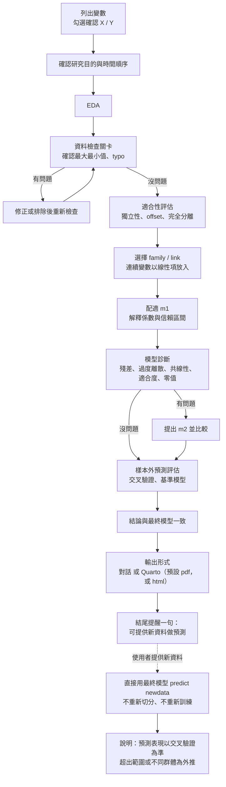

# glm-analysis：廣義線性模型（GLM）分析 Skill

一個給 Claude 使用的 Skill，用 R 帶您走完一套完整的 GLM 分析流程。每個階段都會逐步呈現結果，並用白話解釋統計意涵，不是只丟一堆輸出。

## 這個 Skill 在做什麼

當您提供資料並提出「幫我做 GLM」「邏輯斯迴歸」「卜瓦松迴歸」「這筆資料適合做什麼迴歸」這類需求，Claude 會依序進行四個階段：

| 階段 | 內容 |
|---|---|
| 1. 探索性資料分析（EDA） | 列出所有變數並確認哪些是 X、哪些是 Y；確認研究目的與時間順序；描述性統計與圖表；檢查最大最小值、缺失值、可能的 typo |
| 2. 適合性評估 | 判斷資料適不適合用 GLM（觀測是否獨立、是否需要 offset、是否有完全分離等） |
| 3. 模型配適 | 依反應變數型態挑選 family 與 link，連續解釋變數以線性項放入，先配適一個模型（m1）並解釋係數；類別變數有三個以上水準時，需要比較各組才做多重比較校正 |
| 4. 模型診斷與評估 | 殘差、過度離散、共線性（VIF／GVIF）、適合度、零值檢查，附診斷完成紀錄表；診斷發現問題時才提出調整後的模型（m2）；另做樣本外預測評估（含只有截距的基準模型），最後讓結論與最終模型一致 |

### 分析完成後，也可以預測新資料

輸出完成後，Claude 會在結尾提醒一句可以提供新資料做預測（不會用勾選框詢問）。要預測時，可以直接進行，不需要重新切分、重新訓練。Claude 會說明：預期的預測表現以前面的交叉驗證結果為準，但那是在原資料的分布下估計的；新資料超出原樣本範圍或來自不同群體、時間屬於外推，實際表現可能較差；新資料有真實的 Y 時可直接確認。

### 分析流程圖



輸出形式實際上是在開始分析前所有問題的最後一題，圖中放在最後只是方便閱讀。輸出完成後，Claude 只會在結尾提醒一句可以提供新資料做預測，不會再用勾選框詢問。

### 支援的分布家族

| 反應變數型態 | 初步候選 family | 常用 link |
|---|---|---|
| 單筆二元 0/1 | binomial | logit（亦可 probit、cloglog） |
| 成功數／失敗數 | binomial（cbind） | logit |
| 非負整數計數 | poisson | log |
| 計數且過度離散 | quasipoisson 或 MASS::glm.nb | log |
| 連續、嚴格為正 | Gamma | log 或 inverse |
| 連續、大致對稱 | gaussian | identity |

這些只是建立起始模型的起點，預設先配適一個模型。Skill 的設計原則是**診斷指標是證據，不是自動決策規則**：VIF 大於 5、離散比值大於 1 這類數字都只當警示，會搭配資料結構與研究目的一起判讀。

### 範圍限制

本 Skill **不支援**下列情況，遇到時只會判斷並說明，然後建議改用專門工具：

- 因果推論：只描述變數之間的「關聯」，不使用因果措辭，也不做因果效果估計
- 零膨脹模型（zero-inflated model）與門檻模型（hurdle model）：零值偏多時，先評估過度離散、平均數結構等替代解釋，仍無法解釋才說明兩者的差異，不做配適與解釋
- 重複測量、群聚資料（GLMM、GEE）
- 連續比例資料（beta regression）

## 如何對話

直接用自然語言描述需求，並附上資料（csv、xlsx 等）。不需要說出「GLM」這三個字。

範例：

> 我有一份資料 `visits.csv`，想知道哪些因素會影響看診次數，幫我做廣義線性模型分析。

> 這筆資料的 Y 是 0/1，幫我做邏輯斯迴歸，並用 Quarto 產生 PDF 報告。

> 我已經做完 EDA 了，直接幫我從模型配適開始。

### 三種工作模式

| 模式 | 說明 |
|---|---|
| 完整分析 | 從 EDA 一路做到診斷，每個階段都逐步解釋 |
| 指定步驟 | 只做您指定的階段，例如「只做診斷」 |
| 接續分析 | 您已有部分結果，從中間接手 |

### 流程中 Claude 會問您的事

需要您選擇時，Claude 會用勾選框提問，不會用純文字提問後結束回覆，避免誤以為分析已經結束。

1. **哪個是反應變數（Y）、哪些是解釋變數（X）**：如果您沒說明，Claude 會先列出所有變數再詢問
2. **時間順序**：變數的時間先後為何？哪些變數可能在結果之後才產生？研究目的固定為解釋關聯，不會再詢問
3. **資料是否有問題**：EDA 做完後，Claude 會列出各變數的最大最小值與可疑數值，請您確認有沒有 typo 或怪值，用勾選框回覆沒問題才會繼續
4. **是否有暴露量不同**：計數資料若觀察期間或人口數不同，會詢問是否需要 offset
5. **輸出形式**：所有問題的最後一題，讓您決定在對話中呈現或產出 Quarto 報告

## 語言

預設使用台灣繁體中文回應，專有名詞第一次出現時附註英文（例如「過度離散（overdispersion）」）。

## 輸出方式：對話內，或 Quarto 報告

**不會預設在對話裡分析。** 所有問題問完後，最後一題會用勾選框讓您決定要在對話中呈現，還是產出 Quarto 報告（預設 PDF，也可選 HTML）。請求中已經說明（例如「做成 PDF 報告」）就不會再問。

### 選項一：直接在對話中輸出

結果表格、圖與解釋直接出現在對話裡。除非您主動要求，否則**不會貼出 R 程式碼**，避免干擾閱讀。

### 選項二：產生 Quarto 報告檔

在需求中說明「要報告」「要 PDF」「要 HTML」即可。Skill 附有通用範本 `assets/report_template.qmd`，同一份 qmd 可輸出 PDF 與 HTML。選 Quarto 報告又沒指定格式時，預設輸出 PDF：

| 格式 | 渲染指令 |
|---|---|
| PDF | `LC_ALL=C.UTF-8 quarto render report.qmd --to pdf` |
| HTML | `LC_ALL=C.UTF-8 quarto render report.qmd --to html` |

範本特色：

- 支援繁體中文（PDF 使用 xelatex 與 xeCJK，字型自動依序嘗試）
- 圖表用 `fig-` / `tbl-` 標籤，可交叉引用
- 章節自動編號、目錄、`cache` 加速
- 報告章節與四個分析階段一一對應，含診斷完成紀錄表與只有截距的基準模型比較
- 預設只配適 m1；調整後的 m2 比較區塊預設關閉，需要時再開啟
- 交叉驗證會分別記錄每一折的錯誤、警告與收斂狀況

## 分析在哪裡執行

分析是用 **R** 跑的。依您使用的環境而定：

- **在 Claude 的雲端環境**：Claude 會先檢查 R 是否存在，沒有就安裝（R、MASS、car、ggplot2、dplyr、performance、knitr、rmarkdown、broom、emmeans，DHARMa 為選用，PDF 另需 Quarto 與 LaTeX 相關套件），您的電腦不需要有 R
- **在自己的電腦（Claude Code 等）**：使用您本機的 R 與 Quarto

若環境完全無法執行 R，Skill 規定必須明說，**不可假裝已經跑過分析**。

### 如何確認結果是真的跑出來的

最可靠的做法是重現：

1. 要求 Claude 提供 `.qmd` 或 `.R` 檔，並附上您的資料
2. 在自己的 R／RStudio 重新執行（交叉驗證等隨機步驟有固定種子）
3. 對照數字是否一致

## 安裝方式

### Claude.ai（網頁或桌面版）

1. 到 Releases 下載 `glm-analysis.skill`（或自行把 `glm-analysis` 資料夾壓縮成 zip）
2. 在 Claude 的設定中找到 Skills 並上傳

### Claude Code

把整個 `glm-analysis` 資料夾放到：

```
~/.claude/skills/glm-analysis/
```

專案內使用則放在專案的 `.claude/skills/glm-analysis/`。

## 資料夾結構

```
glm-analysis/
  SKILL.md                              主要指示：工作模式、四個階段的流程與原則
  references/
    family-link-selection.md            依反應變數型態選 family 與 link
    diagnostics-checklist.md            模型診斷清單與判讀注意事項
    model-building-and-validation.md    研究目的、模型比較、交叉驗證
  assets/
    report_template.qmd                 Quarto 報告範本（pdf、html 通用）
```

`SKILL.md` 會在觸發時載入，`references/` 與 `assets/` 的內容則在需要時才讀取。

## 設計原則摘要

- 需要您選擇時一律用勾選框，輸出形式由您決定，不預設在對話中分析
- 先確認研究問題與時間順序，再談模型；結果只描述關聯，不做因果推論
- 連續變數一律以線性項放入，不一開始配適二次方、樣條等非線性；診斷顯示曲線趨勢時只在報告中延伸討論
- 預設只配適一個模型；需要比較模型時（使用者要求，或診斷發現問題），在相同的分析樣本上比較
- 診斷（模型有沒有問題）與預測評估（模型預測得準不準）分開處理；樣本外切分依資料結構決定（時間資料用時間切分、群聚資料以群組切分）
- 診斷結束前列出每項檢查的狀態：已執行、結果受限、不適用、無法執行，不把「沒發現問題」與「沒執行」混為一談
- 類別變數要宣稱「最好」或「排名」，必須做多重比較校正；「不顯著」只能寫成「資料無法區分」，不等於「相同」
- 結論必須與最終模型一致，並報告實際使用的樣本數；撰寫遵守七項原則：簡潔扼要、中立客觀、不無據推論、正確表達不確定性、結論有依據、避免過度解釋、用白話說明，輸出前再檢查一次
- 係數解釋要寫清楚參考組、單位與尺度；odds ratio 不等於風險比

## 限制與提醒

- 這個 Skill 輔助分析流程，不能取代統計專業判斷。重要的研究結論請自行確認
- 模型選擇、變數處理方式會影響結論，Claude 會說明理由，但最終決定在您
- 資料若含個資，上傳前請先去識別化
